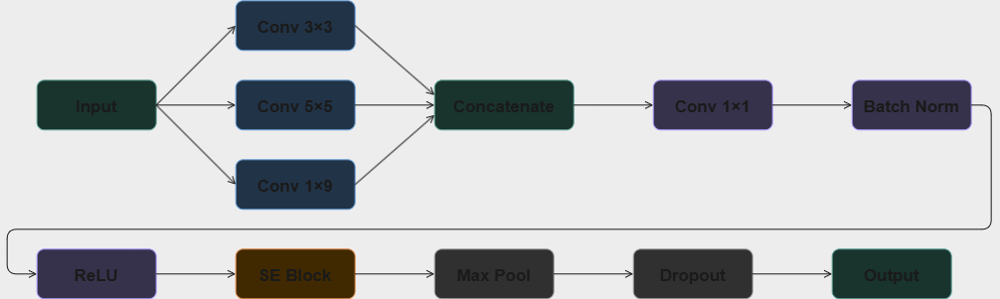
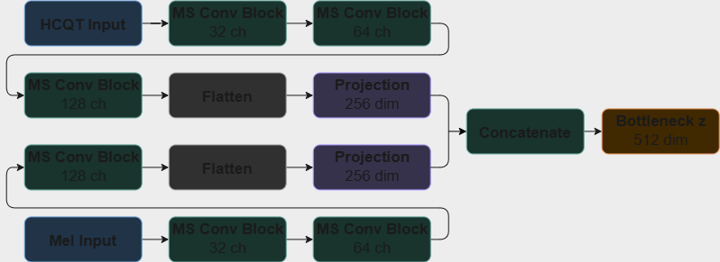
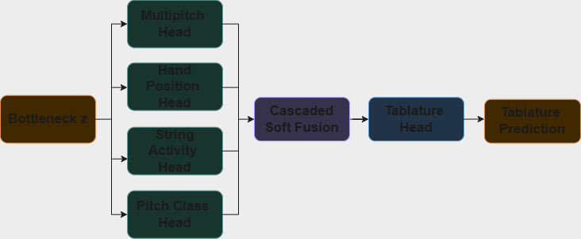
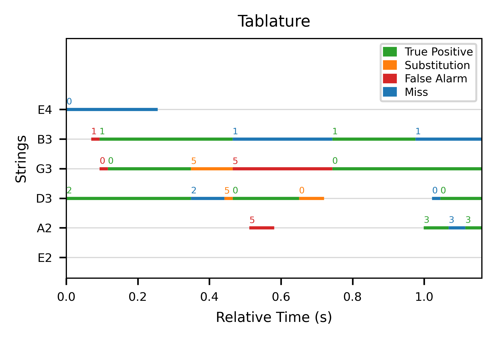
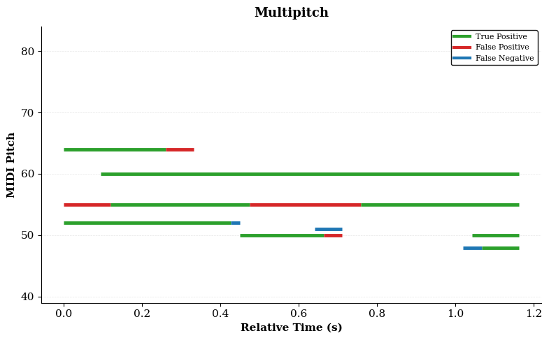

# Cascaded Multi-Task Learning for Automatic Guitar Tablature Transcription

Code for "Automatic Guitar Tablature Transcription using Dual-Representation Feature Fusion and Cascaded Multi-Task Learning".

Guitar tablature transcription requires not only detecting which pitches are played, but determining where on the instrument they are played: the same pitch can be realized at multiple string-fret positions, and the audio signal does not always uniquely determine the position a guitarist chose. Early pipeline-based approaches often treated this positional assignment as a separate or post-processing stage, and even end-to-end systems rarely model it explicitly.

This repository implements a multi-task learning framework that addresses this directly. Two complementary representations, the Harmonic Constant-Q Transform and the Mel-spectrogram, are processed through independent convolutional branches and fused at a shared bottleneck. Rather than mapping this representation directly to tablature, the model first estimates four instrument-informed and pitch-related quantities, estimated hand position, string activity, pitch class, and multi-pitch content, and passes them to the tablature decoder as soft contextual evidence before any string-fret assignment is committed. Gradient Cosine Similarity between each auxiliary loss and the tablature loss is tracked throughout training; the observed values are predominantly positive and exhibit no sustained negative phases, indicating no persistent gradient conflict under the monitored setting.

On GuitarSet, under six-fold leave-one-player-out cross-validation, the proposed configuration reaches a tablature F1 of 0.783 and a Tablature Disambiguation Rate of 0.946, the highest TDR among the baselines considered in this study.

## Contents

- [Architecture](#architecture)
- [Optimization](#optimization)
- [Evaluation metrics](#evaluation-metrics)
- [Results](#results)
- [Repository structure](#repository-structure)
- [Setup](#setup)
- [Reproducing the results](#reproducing-the-results)
- [Dataset](#dataset)
- [Citation](#citation)
- [Acknowledgments](#acknowledgments)
- [License](#license)

## Architecture

The network is built around one guiding principle: tablature should not be predicted directly from raw acoustic features. The model first builds a shared acoustic representation, then estimates a set of instrument-informed intermediate quantities from it, and only then makes the string-fret assignment using all of this information jointly.

### Acoustic representation

The first stage maps two input representations, the Harmonic Constant-Q Transform (HCQT) and the Mel-spectrogram, to a shared bottleneck vector. Concatenating them at the input would force a single set of filters to handle representations that differ in frequency resolution, channel count, and structural content. Instead, each is processed through an independent convolutional branch, so each can learn filters suited to its own input.

The building block of each branch is the Multi-Scale Convolutional Block. The input is processed in three parallel sub-branches with kernel sizes 3x3, 5x5, and 1x9. The asymmetric 1x9 kernel extends along the time axis without blurring frequency resolution, which suits detecting onset transients and the early decay of a note.

<p align="center">
  
  <br>
  <em>Figure 1. Internal structure of a single Multi-Scale Convolutional Block.</em>
</p>

The three sub-branch outputs are concatenated along the channel dimension and reduced back to the block's nominal channel count with a 1x1 convolution, batch normalization, and ReLU. A Squeeze-and-Excitation module then recalibrates the resulting feature map by learning a channel-wise weighting vector from the global average of the activations. Each block ends with 2x2 max-pooling and dropout at a rate of 0.25.

Each branch stacks three such blocks with output widths of 32, 64, and 128 channels. After the third block, the output is flattened and passed through a projection layer to a fixed 256-dimensional embedding before concatenation into the shared bottleneck.

<p align="center">
  
  <br>
  <em>Figure 2. Dual-branch acoustic encoder.</em>
</p>

The two projected embeddings are concatenated to form the shared 512-dimensional bottleneck.

### Cascaded decoding

Once the bottleneck z has been formed, four auxiliary decoders estimate fretboard and pitch-related quantities: estimated hand position, string activity, pitch class, and multi-pitch content. Each is a shallow MLP mapping z to its task-specific output through one hidden layer with ReLU and dropout of 0.25. Crucially, the soft probability vectors, not hard decisions, are passed on, which preserves gradient flow through the auxiliary decoders during training.

The probability vectors from all four decoders are concatenated with the bottleneck to form the augmented input to the tablature head.

<p align="center">
  
  <br>
  <em>Figure 3. Cascaded decoding pipeline.</em>
</p>

The tablature head is a two-layer MLP with a 256-unit hidden layer (dropout 0.5), projecting linearly to a 6x21 output covering six strings and 21 fret states (0 to 19, plus silence).

## Optimization

### Uncertainty-based loss weighting

Each task's loss operates on a different scale. Rather than fixed weights, a trainable log-variance parameter is learned per task, following Kendall et al., automatically down-weighting noisier tasks as training progresses. This keeps a dominant task from overwhelming the others and lets the model converge in a balanced way. See the paper for the full derivation.

### Gradient Cosine Similarity (GCS)

During training, the cosine similarity between each auxiliary task's gradient and the tablature task's gradient, both taken with respect to the shared bottleneck, is tracked as a diagnostic. A positive value indicates the tasks are locally aligned; a negative value indicates local opposition (negative transfer). This is purely observational: it never affects the optimizer's parameter updates, only what gets logged. See `src/trainer.py`'s `_compute_gcs_averaged` and configs' `loss.grad_cos_sim.enabled` toggle.

## Evaluation metrics

**Tablature Disambiguation Rate (TDR)** measures, among the pitches the model detects correctly, what fraction get assigned to the correct string. It isolates string-fret disambiguation from pitch detection accuracy.

**Error rate breakdown** decomposes total transcription error into:
- Substitution error (E_sub): correct string, wrong fret.
- Miss error (E_miss): an active note predicted as silence.
- False alarm error (E_fa): silence predicted as an active note.
- Total error (E_total): the sum of the above, normalized by the reference note count.

## Results

Six ablation configurations were evaluated on GuitarSet with six-fold cross-validation, varying the input representation (CQT, HCQT, HCQT+Mel) and the decoding strategy (single-task head vs. the full cascaded multi-task architecture).

| Features | Setting | P | R | F1 | TDR |
| :--- | :--- | :--- | :--- | :--- | :--- |
| CQT | Single Task | 0.611 ±0.043 | 0.633 ±0.078 | 0.618 ±0.041 | 0.859 ±0.041 |
| CQT | Casc. MT | 0.597 ±0.031 | 0.620 ±0.080 | 0.605 ±0.044 | 0.858 ±0.042 |
| HCQT | Single Task | 0.642 ±0.050 | 0.672 ±0.075 | 0.653 ±0.040 | 0.870 ±0.034 |
| HCQT | Casc. MT | 0.674 ±0.044 | 0.702 ±0.069 | 0.685 ±0.038 | 0.891 ±0.035 |
| HCQT + Mel | Single Task | 0.783 ±0.036 | 0.764 ±0.072 | 0.771 ±0.040 | 0.934 ±0.026 |
| HCQT + Mel | Casc. MT† | **0.800** ±0.036 | **0.771** ±0.063 | **0.783** ±0.036 | **0.946** ±0.026 |

*Table 1. Tablature results for the six ablation configurations. †Proposed configuration.*

| Features | Setting | Tab-derived P | Tab-derived R | Tab-derived F1 | Aux Head P | Aux Head R | Aux Head F1 |
| :--- | :--- | :--- | :--- | :--- | :--- | :--- | :--- |
| CQT | Single Task | 0.821 ±0.044 | 0.735 ±0.061 | 0.773 ±0.028 | --- | --- | --- |
| CQT | Casc. MT | 0.814 ±0.034 | 0.721 ±0.067 | 0.762 ±0.035 | 0.872 ±0.020 | 0.697 ±0.053 | 0.774 ±0.035 |
| HCQT | Single Task | 0.853 ±0.042 | 0.771 ±0.062 | 0.802 ±0.026 | --- | --- | --- |
| HCQT | Casc. MT | 0.843 ±0.036 | 0.787 ±0.051 | 0.812 ±0.022 | 0.887 ±0.019 | 0.775 ±0.044 | 0.826 ±0.023 |
| HCQT + Mel | Single Task | 0.878 ±0.028 | **0.817** ±0.059 | 0.844 ±0.024 | --- | --- | --- |
| HCQT + Mel | Casc. MT† | **0.878** ±0.026 | 0.816 ±0.050 | **0.844** ±0.019 | **0.902** ±0.037 | **0.830** ±0.016 | **0.864** ±0.016 |

*Table 2. Multi-pitch results for the six ablation configurations. "Tab-derived" columns report pitch accuracy collapsed from the tablature output. "Aux Head" columns report the auxiliary multi-pitch decoder output directly. Single-task models have no auxiliary head. †Proposed configuration.*

| Features | Setting | E_sub | E_miss | E_fa | E_total |
| :--- | :--- | :--- | :--- | :--- | :--- |
| CQT | Single Task | 0.103 ±0.025 | 0.264 ±0.074 | 0.307 ±0.096 | 0.675 ±0.053 |
| CQT | Casc. MT | 0.114 ±0.024 | 0.266 ±0.073 | 0.307 ±0.076 | 0.686 ±0.038 |
| HCQT | Single Task | 0.093 ±0.027 | 0.234 ±0.070 | 0.289 ±0.098 | 0.617 ±0.058 |
| HCQT | Casc. MT | 0.083 ±0.023 | 0.214 ±0.064 | 0.260 ±0.078 | 0.558 ±0.050 |
| HCQT + Mel | Single Task | 0.046 ±0.016 | 0.189 ±0.060 | 0.167 ±0.057 | 0.403 ±0.051 |
| HCQT + Mel | Casc. MT† | **0.045** ±0.016 | **0.182** ±0.052 | **0.150** ±0.052 | **0.378** ±0.045 |

*Table 3. Error rate decomposition for the six ablation configurations. †Proposed configuration.*

<p align="center">
  <strong>Ground Truth vs. Model Prediction</strong><br>
  
  <br>
  <em>Figure 4. Tablature output compared against the reference annotation.</em>
</p>

<p align="center">
  <strong>Ground Truth vs. Model Prediction</strong><br>
  
  <br>
  <em>Figure 5. Pianoroll (multi-pitch) comparison against the reference annotation.</em>
</p>

## Repository structure

```text
Guitar-Transcription/
├── assets/                      Architecture diagrams and result figures used in this README
├── configs/
│   └── cnn_mtl_config.yaml      configuration
├── src/
│   ├── data_loader.py           GuitarSet .npz dataset and dataloader construction
│   ├── trainer.py               Training loop, checkpointing, GCS diagnostic
│   ├── models/
│   │   ├── base_model.py
│   │   └── cnn_mtl.py            The cascaded multi-task architecture
│   └── utils/
│       ├── agt_tools.py          Tablature / multi-pitch / logistic representation conversions
│       ├── analyze_errors.py     Confusion matrices and per-string error analysis
│       ├── callbacks.py          Early stopping / checkpoint-selection callbacks
│       ├── config_helpers.py     Config processing, optimizer/scheduler/device construction
│       ├── experiment.py         Experiment directory creation and report generation
│       ├── guitar_profile.py
│       ├── logger.py             Logging setup (UTF-8 console output)
│       ├── losses.py             Focal loss, uncertainty-weighted multi-task loss
│       ├── metrics.py            Tablature/TDR/multi-pitch/error-rate metric computation
│       └── plotting.py
├── extract_features.py          Raw GuitarSet audio -> feature-enriched .npz files
├── train.py                     Six-fold cross-validation training entry point
├── evaluate.py                  Evaluation pipeline
├── pyproject.toml               Dependencies, managed with uv
├── terminal_cheatsheet.md       Full CLI reference for every script in this repo
├── LICENSE
└── README.md
```

## Setup

> **Note:** All results reported in the paper were produced on Google Colab. This repository exists to share the code itself; the setup below documents a standalone local environment and is provided for reference/reproducibility rather than reflecting the authors' own development setup.

Dependencies are managed with [uv](https://docs.astral.sh/uv/) and pinned in `pyproject.toml`. Two separate environments are needed:

**Main environment (Python 3.12), for `train.py` and `evaluate.py`:**

```bash
uv sync
```

`torch`/`torchaudio`/`torchvision` are pulled from PyTorch's CUDA 12.6 index on Windows/Linux automatically, so this gives a GPU-enabled install out of the box if an NVIDIA GPU and driver are present. Training on CPU works but is impractical at full scale; the paper's runs used an A100.

**Feature-extraction environment (Python 3.11), for `extract_features.py` only:**

```bash
uv venv --python 3.11 .venv-extract
uv pip install --python .venv-extract/bin/python numpy librosa "setuptools<81" \
    "amt-tools @ git+https://github.com/cwitkowitz/amt-tools" \
    "guitar-transcription-continuous @ git+https://github.com/cwitkowitz/guitar-transcription-continuous"
```

This needs its own environment because `guitar-transcription-continuous` depends on `muda`, an unmaintained package whose setup script imports the `imp` standard-library module, which was removed in Python 3.12. It builds fine under 3.11. The `setuptools<81` pin is also required: `muda` still imports `pkg_resources`, which setuptools >=81 no longer ships. This step is only needed once, to go from raw GuitarSet audio to `.npz` files; it is not required for training or evaluation once those files exist.

Full flag-by-flag documentation for every script is in [`terminal_cheatsheet.md`](terminal_cheatsheet.md).

## Reproducing the results

**1. Extract features** from raw GuitarSet audio:

```bash
.venv-extract/bin/python extract_features.py \
    --guitarset-root /path/to/GuitarSet \
    --output-dir /path/to/output
```

This writes feature-enriched `.npz` files (HCQT, CQT, Mel, STFT, power, and the hand_position/string_activity/pitch_class auxiliary targets) to `/path/to/output/enriched/`.

**2. Train** the proposed configuration across all six folds:

```bash
.venv/bin/python train.py \
    --config configs/cnn_mtl_config.yaml \
    --data-root /path/to/output/enriched \
    --output-root /path/to/outputs
```

Each fold trains one model (fold i holds out player i for testing and uses player (i+1) mod 6 for validation) and is evaluated automatically once training finishes, using the leak-free pipeline described below. Checkpoints, training curves, and per-fold reports land in `/path/to/outputs/cnn_mtl_<timestamp>/fold_<n>/`.

**3. Evaluate** any existing experiment directory manually, without retraining:

```bash
.venv/bin/python evaluate.py \
    --experiment-path /path/to/outputs/cnn_mtl_<timestamp> \
    --data-root /path/to/output/enriched
```

Per fold, this loads `fold_<n>/model_best.pt`, runs whole-track inference, grid-searches the silence-recovery probability threshold on the *validation* player only, and applies the winning threshold to the held-out *test* player.

On Windows, pass `--num-workers 0` to `train.py`: multiprocessing DataLoader workers reliably segfault there, a PyTorch/Windows limitation unrelated to this code. See `terminal_cheatsheet.md` for this and other platform notes.

## Dataset

Experiments use [GuitarSet](https://guitarset.weebly.com/), a corpus of about three hours of acoustic guitar audio from six players, with per-string pitch and fret annotations.

## Citation

The paper is currently under review at IEEE Access. Until it is formally published:

```
K. Kesimal, M. E. Reyhanlıoğlu, O. Gök, and H. Özcan,
"Automatic Guitar Tablature Transcription using Dual-Representation Feature Fusion and Cascaded Multi-Task Learning,"
submitted to IEEE Access.
```

## Acknowledgments

- GuitarSet: Xi, Q., Bittner, R. M., Pauwels, J., Ye, X., and Bello, J. P., "GuitarSet: A Dataset for Guitar Transcription," ISMIR 2018.
- Feature extraction in this repository builds on [amt-tools](https://github.com/cwitkowitz/amt-tools) and [guitar-transcription-continuous](https://github.com/cwitkowitz/guitar-transcription-continuous) by Frank Cwitkowitz.
- This work was supported by the Kocaeli University Scientific Research Projects Coordination Unit under Project No. FBA-2026-5333.

## License

MIT. See [LICENSE](LICENSE).
