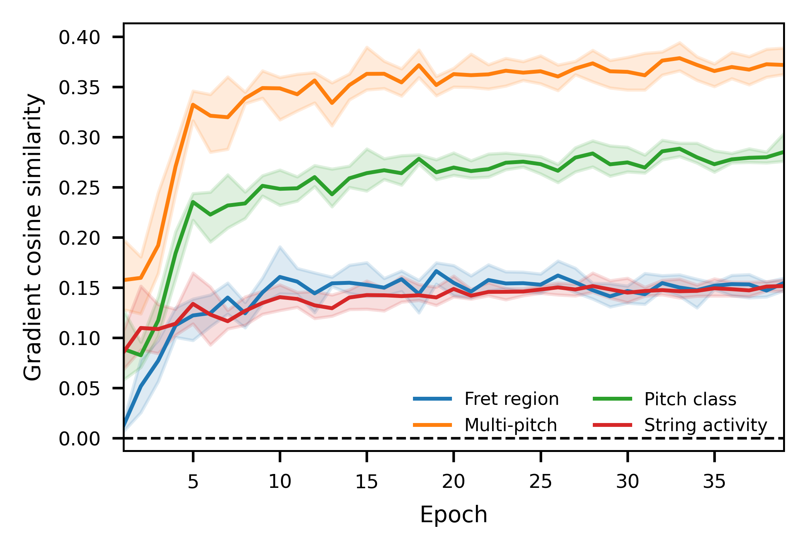
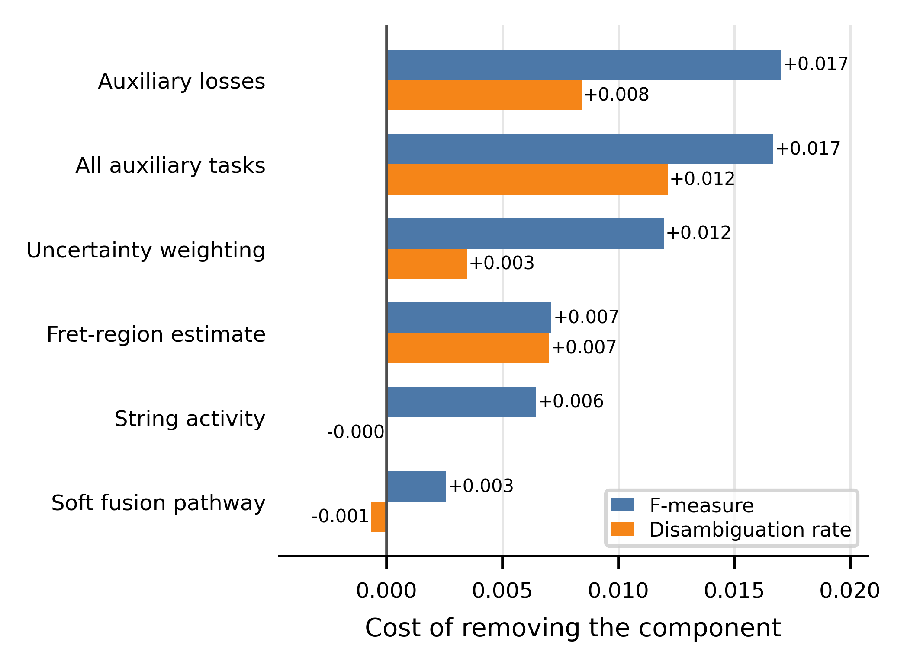
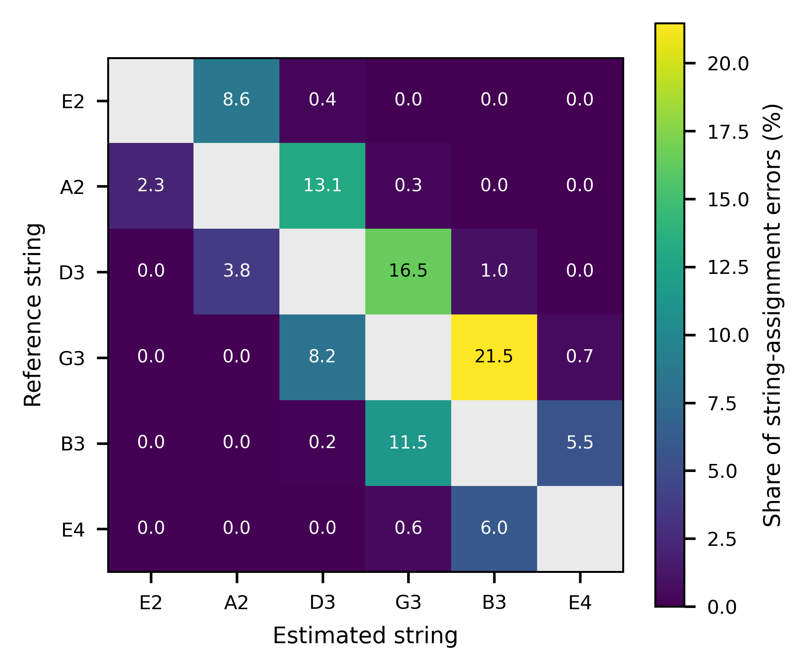

# Instrument-Informed Multi-Task Learning for Guitar Tablature Transcription

Code for "Automatic Guitar Tablature Transcription using Dual Representation Feature Fusion and Instrument Informed Multi-Task Learning".

Guitar tablature transcription requires not only detecting which pitches are played, but determining where on the instrument they are played. The same pitch can be realized at multiple string-fret positions, and the audio signal does not always uniquely determine the position selected by the guitarist. Early pipeline-based approaches treated positional assignment as a separate stage, and even end-to-end systems rarely model it explicitly.

This repository implements a multi-task learning framework in which two complementary representations, the Harmonic Constant-Q Transform and the Mel-spectrogram, are processed through independent convolutional branches and fused at a shared bottleneck. Rather than mapping this representation directly to tablature, the model first estimates four instrument-informed quantities: a fret-region estimate, string activity, pitch class, and multi-pitch content. These estimates are passed to the tablature decoder as soft contextual evidence before any string-fret assignment is committed. Gradient Cosine Similarity between each auxiliary loss and the tablature loss is positive on average, indicating representation-level alignment without ruling out negative transfer.

On GuitarSet, under six-fold leave-one-player-out cross-validation, the framework achieves a tablature F1 of 0.776 and a Tablature Disambiguation Rate of 0.943. Thus 5.7% of correctly detected pitches are assigned to the wrong string, compared with 7.4% to 10.1% for the baselines considered. A component ablation supports a benefit from auxiliary supervision but detects no additional benefit from forwarding the auxiliary outputs. The F-measure does not exceed the strongest reported baseline, so the evidence supports improved string-fret disambiguation rather than overall accuracy.

## Contents

- [Architecture](#architecture)
- [Optimization](#optimization)
- [Evaluation metrics](#evaluation-metrics)
- [Results](#results)
- [Repository structure](#repository-structure)
- [Setup](#setup)
- [Pretrained weights](#pretrained-weights)
- [Reproducing the results](#reproducing-the-results)
- [Dataset](#dataset)
- [Citation](#citation)
- [Acknowledgments](#acknowledgments)
- [License](#license)

## Architecture

The network is built around one guiding principle: tablature should not be predicted directly from raw acoustic features. The model first builds a shared acoustic representation, then estimates a set of instrument-informed intermediate quantities from it, and only then makes the string-fret assignment using all of this information jointly.

### Acoustic representation

The first stage maps two input representations to a shared bottleneck vector. The HCQT stacks six CQT planes (harmonics 0.5, 1, 2, 3, 4, 5; 36 bins per octave over four octaves from E2, 144 bins per plane), so that overtone structure lines up along its own tensor dimension. The Mel-spectrogram (256 bands, 2048-point FFT) adds the broadband, transient evidence that a pitch-centric representation underrepresents. Audio is resampled to 22.05 kHz with a hop of 512 samples, and the model sees a 19-frame context window centred on the target frame (about 209 ms on each side).

Concatenating the two representations at the input would force a single set of filters to handle inputs that differ in frequency resolution, channel count, and structure. Each is therefore processed by its own convolutional branch.

The building block of each branch is the Multi-Scale Convolutional Block. The input is processed in three parallel sub-branches with kernel sizes 3x3, 5x5, and 1x9, each made of two convolution, batch-normalization and ReLU stages. The asymmetric 1x9 kernel extends along the time axis without blurring frequency resolution, which suits onset transients and the early decay of a note.

<p align="center">
  
  <br>
  <em>Figure 1. Internal structure of a single Multi-Scale Convolutional Block.</em>
</p>

The three sub-branch outputs are concatenated along the channel dimension and reduced back to the block's channel count with a 1x1 convolution, batch normalization, and ReLU. A Squeeze-and-Excitation module (reduction ratio 16) then reweights the channels. Each block ends with 2x2 max-pooling and dropout at a rate of 0.25.

Each branch stacks three such blocks with 32, 64, and 128 channels. The output is flattened and projected to a 256-dimensional embedding (4,608 and 8,192 flattened dimensions for the HCQT and Mel branches), and the two embeddings are concatenated into the shared 512-dimensional bottleneck. The two fully connected projections account for 3.28 million of the model's 6.65 million parameters; a cheaper interface would reduce this cost without changing the design.

<p align="center">
  
  <br>
  <em>Figure 2. Dual-branch acoustic encoder.</em>
</p>

### Cascaded decoding

From the bottleneck z, four auxiliary decoders estimate fretboard- and pitch-related quantities:

- **Fret-region estimate** (5 classes): the mean fret of the active fretted notes in the frame, quantized into no fretted note, frets 1-5, 6-10, 11-15, and above 15. Open strings are left out of the mean because they do not pin down a fretting-hand location. This is a coarse fret-region prior, not a measurement of hand position: for a wide voicing the mean can fall on a fret that is not pressed.
- **String activity** (6 outputs): which strings are sounding, regardless of fret.
- **Pitch class** (12 outputs): octave-invariant harmonic context.
- **Multi-pitch** (49 outputs, MIDI 40-88): the active pitches, with octave information.

Each decoder is a one-hidden-layer MLP with ReLU and dropout of 0.25 (256 hidden units for multi-pitch, 128 for fret region and pitch class, 64 for string activity). Their soft probability vectors, not hard decisions, are concatenated with z into the 584-dimensional input of the tablature head, so the tablature loss also reaches the auxiliary decoders.

<p align="center">
  
  <br>
  <em>Figure 3. Cascaded decoding pipeline.</em>
</p>

The tablature head is a two-layer MLP with a 256-unit hidden layer (dropout 0.5), projecting to a 6x21 output covering six strings and 21 fret states (frets 0 to 19, plus silence). The component ablation below supports the benefit of supervising the intermediate quantities, but detects no separate benefit from forwarding them to the tablature head.

In code and in the feature files the fret-region target keeps its original name, `hand_position`, so existing feature files and checkpoints stay compatible.

## Optimization

### Uncertainty-based loss weighting

The five losses (focal loss for tablature, cross-entropy for the fret region, binary cross-entropy for the other three) are combined with the uncertainty weighting of Kendall et al.: each task has a trainable log-variance s, its loss is scaled by exp(-s)/2, and s/2 is added as a regularizer. All log-variances start at 0. The joint optimization was stable in the reported runs: across the five objectives and six folds of the main run, the largest change of a log-variance between consecutive epochs was 0.078.

### Gradient Cosine Similarity (GCS)

At the end of every epoch, the cosine similarity between the gradient of each auxiliary loss and that of the tablature loss, both taken with respect to the shared bottleneck z, is averaged over the first 15 batches of the training loader with the model in evaluation mode. It is purely a diagnostic and never affects training. A positive value means the two losses pulled the shared representation in directions with a positive inner product in the monitored batches. Because it is measured on the representation rather than on the parameters, and because the tablature loss also flows through the auxiliary decoders, a positive value does not show that negative transfer is absent. See `Trainer._compute_gcs_averaged` in `src/trainer.py` and `loss.grad_cos_sim` in the config.

<p align="center">
  
  <br>
  <em>Figure 4. Gradient cosine similarity of each auxiliary loss with the tablature loss, for the component campaign's control run: mean and range over six folds, up to the last epoch reached by every fold.</em>
</p>

Multi-pitch shows the largest mean alignment, followed by pitch class, with smaller means for the fret region and string activity. The fold mean is positive for every auxiliary task; one fret-region epoch of the main run is slightly negative (-0.0037), while the control run has no negative monitored epoch.

## Evaluation metrics

Tablature F-measure counts a prediction as correct only if the fret matches on the correct string. Multi-pitch F-measure collapses the tablature output into a frame-level pitch activation, discarding string identity.

**Tablature Disambiguation Rate (TDR)** measures, among the pitches the model detects correctly, what fraction get assigned to the correct string. It isolates string-fret disambiguation from pitch detection accuracy.

**Error rate breakdown** decomposes total transcription error at the frame-string level into:
- Substitution error (E_sub): correct string, wrong fret.
- Miss error (E_miss): an active note predicted as silence.
- False alarm error (E_fa): silence predicted as an active note.
- Total error (E_total): the sum of the above, normalized by the reference note count (it can exceed 1).

A wrong-string assignment appears as a miss on one string and a false alarm on another, so it is analyzed separately through TDR.

At test time, a silence prediction is reassigned to its most probable fret when that fret's probability exceeds a threshold chosen per fold on the validation player (0.20 to 0.50 in steps of 0.05). Test tracks are evaluated in full.

## Results

All results are on GuitarSet under six-fold leave-one-player-out cross-validation (fold i tests on player i and validates on player i+1), as mean ± population standard deviation over the six held-out players.

### Input representation and decoding strategy

| Features | Setting | P | R | F1 | TDR |
| :--- | :--- | :--- | :--- | :--- | :--- |
| CQT | Single Task | 0.649 ±0.045 | 0.678 ±0.089 | 0.659 ±0.045 | 0.868 ±0.043 |
| CQT | Casc. MT | 0.646 ±0.052 | 0.662 ±0.084 | 0.649 ±0.044 | 0.861 ±0.042 |
| HCQT | Single Task | 0.700 ±0.028 | 0.718 ±0.065 | 0.706 ±0.031 | 0.892 ±0.029 |
| HCQT | Casc. MT | 0.718 ±0.033 | 0.706 ±0.081 | 0.709 ±0.048 | 0.892 ±0.038 |
| HCQT + Mel | Single Task | 0.768 ±0.040 | 0.751 ±0.072 | 0.757 ±0.044 | 0.925 ±0.031 |
| HCQT + Mel | Casc. MT† | **0.794** ±0.021 | **0.763** ±0.063 | **0.776** ±0.034 | **0.943** ±0.025 |

*Table 1. Tablature results for the six input and decoding configurations. †Proposed configuration.*

Replacing the CQT with the HCQT, and then adding the Mel-spectrogram, give improvements of comparable size. With the dual-stream input, the cascaded multi-task stage raises TDR from 0.925 to 0.943 (positive in all six folds, exact Wilcoxon p = 0.031) while tab-derived multi-pitch F1 stays at 0.841 vs. 0.840, so the gain is concentrated in string assignment rather than pitch detection. The F-measure difference (+0.020, positive in four folds, p = 0.156) is not detected. Under the HCQT alone the two decoding strategies give similar averages, and under the CQT the multi-task stage does not help.

| Features | Setting | Tab-derived P | Tab-derived R | Tab-derived F1 | Aux Head P | Aux Head R | Aux Head F1 |
| :--- | :--- | :--- | :--- | :--- | :--- | :--- | :--- |
| CQT | Single Task | 0.842 ±0.040 | 0.780 ±0.069 | 0.807 ±0.031 | --- | --- | --- |
| CQT | Casc. MT | 0.844 ±0.053 | 0.767 ±0.065 | 0.800 ±0.032 | 0.870 ±0.024 | 0.794 ±0.050 | 0.829 ±0.023 |
| HCQT | Single Task | 0.857 ±0.034 | 0.805 ±0.052 | 0.828 ±0.023 | --- | --- | --- |
| HCQT | Casc. MT | 0.873 ±0.028 | 0.790 ±0.064 | 0.827 ±0.031 | 0.898 ±0.017 | 0.812 ±0.047 | 0.852 ±0.023 |
| HCQT + Mel | Single Task | 0.876 ±0.021 | 0.812 ±0.057 | 0.841 ±0.024 | --- | --- | --- |
| HCQT + Mel | Casc. MT† | 0.878 ±0.023 | 0.809 ±0.049 | 0.840 ±0.020 | **0.902** ±0.015 | **0.820** ±0.036 | **0.858** ±0.015 |

*Table 2. Multi-pitch results. "Tab-derived" collapses the tablature output into pitch activations; "Aux Head" reads the auxiliary multi-pitch decoder directly. Single-task models have no auxiliary head. †Proposed configuration.*

| Features | Setting | E_sub | E_miss | E_fa | E_total |
| :--- | :--- | :--- | :--- | :--- | :--- |
| CQT | Single Task | 0.087 ±0.024 | 0.235 ±0.079 | 0.288 ±0.103 | 0.609 ±0.055 |
| CQT | Casc. MT | 0.095 ±0.025 | 0.243 ±0.080 | 0.279 ±0.111 | 0.617 ±0.066 |
| HCQT | Single Task | 0.069 ±0.015 | 0.213 ±0.055 | 0.242 ±0.068 | 0.524 ±0.034 |
| HCQT | Casc. MT | 0.066 ±0.016 | 0.228 ±0.068 | 0.213 ±0.059 | 0.508 ±0.050 |
| HCQT + Mel | Single Task | 0.052 ±0.021 | 0.197 ±0.056 | 0.177 ±0.054 | 0.426 ±0.054 |
| HCQT + Mel | Casc. MT† | **0.048** ±0.015 | **0.189** ±0.050 | **0.151** ±0.040 | **0.388** ±0.033 |

*Table 3. Error rate decomposition. †Proposed configuration.*

| Auxiliary task | CQT | HCQT | HCQT + Mel |
| :--- | :--- | :--- | :--- |
| Fret region (accuracy) | 0.701 | 0.760 | 0.842 |
| String activity (F1) | 0.764 | 0.786 | 0.836 |
| Pitch class (F1) | 0.705 | 0.717 | 0.719 |
| Multi-pitch (F1) | 0.829 | 0.852 | 0.858 |

*Table 4. Auxiliary decoder accuracy of the cascaded models under the three input representations. The two quantities that describe where a note is played improve most with the broadband branch.*

### Isolating the components of the multi-task stage

Switching from the single-task to the cascaded configuration changes four things at once: auxiliary supervision, the auxiliary decoders' parameters, the soft fusion into the tablature head, and the loss weighting. Six further configurations, trained with the dual-stream input on the same folds against a control run trained in the same campaign, separate them.

| Configuration | F1 | ΔF1 | TDR | ΔTDR |
| :--- | :--- | :--- | :--- | :--- |
| Full cascade, control re-run | 0.784 ±0.040 | -- | 0.944 ±0.026 | -- |
| Single task, parameter-matched | 0.767 ±0.040 | -0.017* | 0.931 ±0.028 | -0.012* |
| Fusion, no auxiliary loss | 0.767 ±0.037 | -0.017* | 0.935 ±0.029 | -0.008 |
| Auxiliary loss, no fusion | 0.781 ±0.039 | -0.003 | 0.944 ±0.028 | +0.001 |
| Static loss weighting | 0.772 ±0.035 | -0.012* | 0.940 ±0.023 | -0.003 |
| No fret-region estimate | 0.777 ±0.036 | -0.007 | 0.937 ±0.026 | -0.007* |
| No string activity | 0.777 ±0.036 | -0.006 | 0.944 ±0.024 | +0.000 |

*Table 5. Effect of removing one component, relative to the campaign control. \*Same direction in all six folds (smallest attainable two-sided Wilcoxon p at n = 6: 0.031).*

<p align="center">
  
  <br>
  <em>Figure 5. Mean paired cost of removing each component over six folds.</em>
</p>

Removing the auxiliary losses lowers the F-measure in all six folds, and a parameter-matched single-task model falls by the same margin, so parameter count alone does not explain the difference. Removing the soft fusion pathway while keeping the auxiliary losses changes almost nothing, so no benefit from forwarding the auxiliary outputs is detected (which does not demonstrate equivalence). Removing the fret-region estimate lowers TDR in all six folds, while removing string activity does not. The fusion pathway is kept in the proposed model to preserve the evaluated architecture. Pitch class and multi-pitch were not removed individually, so the attribution is partial.

### Where the string-assignment errors are

Among correctly detected pitches, the proposed model places 3.6% of open-string notes and 6.1% of fretted notes on the wrong string, and 3.6% of low-fret notes against 8.6% of high-fret notes. The single-task model is worse in every one of these conditions. Pitches with a single playable position show no wrong-string errors, as expected by construction.

<p align="center">
  
  <br>
  <em>Figure 6. String-assignment confusions, as a percentage of all such errors (diagonal omitted).</em>
</p>

The confusions are almost entirely local: 96.9% of wrong-string errors land on a string adjacent to the correct one. The most frequent case is a note played on G3 and assigned to B3 (21.5% of all errors), followed by D3 assigned to G3 (16.5%) and A2 assigned to D3 (13.1%).

<p align="center">
  <strong>Ground Truth vs. Model Prediction</strong><br>
  
  <br>
  <em>Figure 7. Tablature error overlay for 00_SS3-98-C_solo, frames 985-1035.</em>
</p>

<p align="center">
  
  <br>
  <em>Figure 8. Multi-pitch error overlay for the same excerpt.</em>
</p>

### Comparison with prior work and inference cost

The proposed model's TDR of 0.943 compares with 0.926 for TPMNet and 0.918 for the frame-level system of Kim et al., while its tablature F1 of 0.776 is below TPMNet's 0.788. These baseline values come from independently implemented pipelines, so no significance claim is made; see the paper for the full comparison.

| Model | Params (M) | MACs per frame (M) | RTF, GPU | RTF, CPU | F1 | TDR |
| :--- | :--- | :--- | :--- | :--- | :--- | :--- |
| TabCNN | 0.83 | 39 | 0.0002 | 0.021 | 0.748 | 0.899 |
| Single task | 6.32 | 1331 | 0.0051 | 0.689 | 0.757 | 0.925 |
| Cascaded MT† | 6.65 | 1331 | 0.0051 | 0.615 | 0.776 | 0.943 |

*Table 6. Inference cost and accuracy. Float32, batches of 431 frames (10 s of audio); GPU: median of 30 runs on an A100, CPU: median of 5 runs with six threads. Feature extraction is excluded, and MACs count convolution and linear layers only. TabCNN accuracy as reported in its paper. †Proposed configuration.*

The network alone runs faster than real time on either device. This is not an end-to-end streaming latency: the centred window needs about 209 ms of future context, and transform and buffering latency come on top.

## Repository structure

```text
Guitar-Transcription/
├── assets/                      Architecture diagrams and result figures used in this README
├── configs/
│   ├── cnn_mtl_config.yaml      The proposed HCQT+Mel cascaded configuration
│   └── ablations/               One config per other reported run (Tables 1 and 5)
├── src/
│   ├── data_loader.py           GuitarSet .npz dataset, dataloaders, fold split
│   ├── trainer.py               Training loop, checkpointing, GCS diagnostic
│   ├── models/
│   │   ├── base_model.py
│   │   └── cnn_mtl.py           The cascaded multi-task architecture
│   └── utils/
│       ├── agt_tools.py         Tablature / multi-pitch / logistic representation conversions
│       ├── analyze_errors.py    Confusion matrices and per-string error analysis
│       ├── callbacks.py         Early stopping
│       ├── config_helpers.py    Config processing, optimizer/scheduler/device construction
│       ├── experiment.py        Experiment directory creation and report generation
│       ├── guitar_profile.py    Instrument tuning/fret-range profile
│       ├── logger.py            Logging setup
│       ├── losses.py            Focal loss, uncertainty-weighted multi-task loss
│       ├── metrics.py           Tablature/TDR/multi-pitch/error-rate/wrong-string metrics
│       ├── plotting.py
│       └── preflight.py         Dataset, split and objective checks run before training
├── extract_features.py          Raw GuitarSet audio -> feature-enriched .npz files
├── train.py                     Six-fold cross-validation training entry point
├── evaluate.py                  Evaluation pipeline (produces the reported numbers)
├── summarize_results.py         Result tables, paired tests, GCS and loss-weight statistics
├── make_figures.py              The figures above
├── benchmark_cost.py            Parameters, MACs and real-time factor
├── pyproject.toml               Dependencies, managed with uv
├── terminal_cheatsheet.md       Full CLI reference for every script in this repo
├── LICENSE
└── README.md
```

## Setup

> **Note:** All results reported in the paper were produced on Google Colab (A100). This repository exists to share the code itself; the setup below documents a standalone local environment.

Dependencies are managed with [uv](https://docs.astral.sh/uv/) and pinned in `pyproject.toml`. Two separate environments are needed:

**Main environment (Python 3.12 or 3.13), for training, evaluation and analysis:**

```bash
uv sync
```

`torch` 2.11.0 / `torchaudio` / `torchvision` are pulled from PyTorch's CUDA 12.8 index on Windows/Linux, so this gives a GPU-enabled install if an NVIDIA GPU and driver are present. The paper's runs used torch 2.11.0: the six runs of Table 1 were trained with the CUDA 12.8 build, and the component campaign and the final evaluation ran on the CUDA 13.0 build. Training on CPU works but is impractical at full scale.

**Feature-extraction environment (Python 3.11), for `extract_features.py` only:**

```bash
uv venv --python 3.11 .venv-extract
uv pip install --python .venv-extract/bin/python numpy librosa "setuptools<81" \
    "amt-tools @ git+https://github.com/cwitkowitz/amt-tools" \
    "guitar-transcription-continuous @ git+https://github.com/cwitkowitz/guitar-transcription-continuous"
```

This needs its own environment because `guitar-transcription-continuous` depends on `muda`, an unmaintained package whose setup script imports the `imp` standard-library module, which was removed in Python 3.12. The `setuptools<81` pin is also required: `muda` still imports `pkg_resources`, which setuptools >=81 no longer ships. This step is only needed once, to go from raw GuitarSet audio to `.npz` files.

Full flag-by-flag documentation for every script is in [`terminal_cheatsheet.md`](terminal_cheatsheet.md).

## Pretrained weights

Trained checkpoints for the proposed HCQT+Mel cascaded configuration (all six folds, the run reported in Table 1) are hosted separately in [Guitar-Transcription-Weights](https://github.com/ErenReyhanlioglu/Guitar-Transcription-Weights) to keep this repository lightweight. They load into `src/models/cnn_mtl.py` with `configs/cnn_mtl_config.yaml`; fold i was tested on player i and validated on player i+1. Weights for every ablation run in Tables 1 and 5 are attached to that repository's [`ablation-runs` release](https://github.com/ErenReyhanlioglu/Guitar-Transcription-Weights/releases/tag/ablation-runs), one zip per config in `configs/ablations/`.

## Reproducing the results

**1. Extract features** from raw GuitarSet audio:

```bash
.venv-extract/bin/python extract_features.py \
    --guitarset-root /path/to/GuitarSet \
    --output-dir /path/to/output
```

This writes feature-enriched `.npz` files (HCQT, CQT, Mel, STFT, power, and the fret-region / string-activity / pitch-class targets) to `/path/to/output/enriched/`.

**2. Train** the proposed configuration across all six folds:

```bash
.venv/bin/python train.py \
    --config configs/cnn_mtl_config.yaml \
    --data-root /path/to/output/enriched \
    --output-root /path/to/outputs
```

Before training, `train.py` checks that every player shares the same repertoire, that no feature file is duplicated or malformed, that every fold's train, validation and test files are disjoint, and that the composite loss matches the configured objective on a real batch; it stops if any check fails. Each fold then trains one model and is evaluated automatically once training finishes. Checkpoints, training curves, and per-fold reports land in `/path/to/outputs/cnn_mtl_<timestamp>/fold_<n>/`.

The other reported runs use the same command with a config from `configs/ablations/`: the five other configurations of Table 1 (`cqt_single`, `cqt_casc`, `hcqt_single`, `hcqt_casc`, `hcqt_mel_single`) and the component campaign of Table 5 (`campaign_control` and `A_no_fusion` to `F_static_weighting`). Each is identical to the config its reported run was trained with; the campaign configs also reseed at the start of every fold, as that campaign did.

**3. Evaluate** any existing experiment directory without retraining:

```bash
.venv/bin/python evaluate.py \
    --experiment-path /path/to/outputs/cnn_mtl_<timestamp> \
    --data-root /path/to/output/enriched
```

Per fold, this loads `fold_<n>/model_best.pt`, runs whole-track inference, selects the silence-recovery threshold on the *validation* player only, and applies it to the held-out *test* player. Results, including auxiliary-head accuracy and the wrong-string breakdown, go to `fold_<n>/test_results.json` and `k-fold_test_results.txt`.

**4. Summarize** one or more evaluated experiments into the result tables, with fold-paired comparisons (mean difference, 95% t interval, Cohen's d_z, exact Wilcoxon p) against a reference run:

```bash
.venv/bin/python summarize_results.py \
    --run proposed=/path/to/outputs/<proposed run> \
    --run campaign_control=/path/to/outputs/<control run> \
    --run A_no_fusion=/path/to/outputs/<A run> \
    --reference campaign_control --output-dir results
```

**5. Figures and cost:**

```bash
.venv/bin/python make_figures.py --results-dir results \
    --gcs-run /path/to/outputs/<control run> \
    --overlay-run /path/to/outputs/<proposed run> --data-root /path/to/output/enriched
.venv/bin/python benchmark_cost.py --output cost.json
```

On Windows, pass `--num-workers 0` to `train.py`: multiprocessing DataLoader workers reliably segfault there, a PyTorch/Windows limitation unrelated to this code. See `terminal_cheatsheet.md` for this and other platform notes.

## Dataset

Experiments use [GuitarSet](https://guitarset.weebly.com/) (annotations version 1.1.0), about three hours of acoustic guitar audio: six players each recording the same 60 excerpts, with per-string pitch and fret annotations. Only the reference microphone recording is used as model input. Because every player records the same repertoire, the protocol tests generalization to an unseen performer, not to unseen material.

## Citation

The paper is currently under review at IEEE Access. Until it is formally published:

```
K. Kesimal, M. E. Reyhanlıoğlu, O. Gök, and H. Özcan,
"Automatic Guitar Tablature Transcription using Dual Representation Feature Fusion and Instrument Informed Multi-Task Learning,"
submitted to IEEE Access.
```

## Acknowledgments

- GuitarSet: Xi, Q., Bittner, R. M., Pauwels, J., Ye, X., and Bello, J. P., "GuitarSet: A Dataset for Guitar Transcription," ISMIR 2018.
- Feature extraction in this repository builds on [amt-tools](https://github.com/cwitkowitz/amt-tools) and [guitar-transcription-continuous](https://github.com/cwitkowitz/guitar-transcription-continuous) by Frank Cwitkowitz.
- This work was supported by the Kocaeli University Scientific Research Projects Coordination Unit (BAP) under Project No. FBA-2026-5333.

## License

MIT. See [LICENSE](LICENSE).
